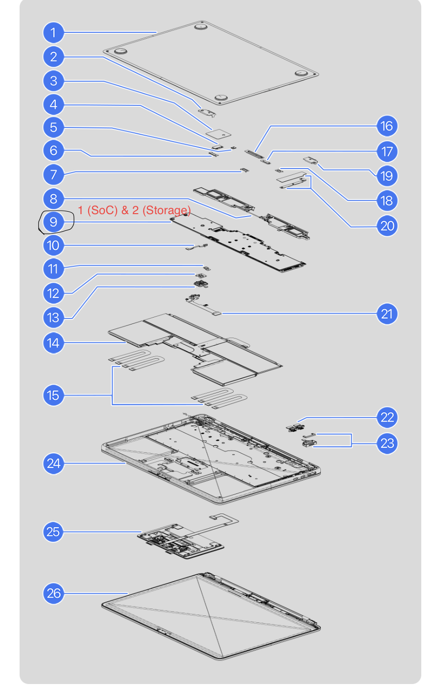

# Lab 3 — Teardown, and the same machine from the command line

Pair: Samira Aubakirova
Machine: MacBook Air M5 (Mac17,3)
Date: October 29, 2026

## 1. The Machine
Exact Model: MacBook Air (M5), Model Identifier: `Mac17,3`
How I found it: I used the command `system_profiler SPHardwareDataType` in the macOS terminal.
Service Manual: [Apple Self Service Repair Manual for MacBook Air 13-inch M5](https://cdsassets.apple.com/live/6GJYWVAV/information/macbook-air-13inch-m5-2026-info.pdf)

## 2. Components

1. What: Apple M5 System on Chip (SoC) containing CPU, GPU, and Unified Memory.
Connects to: Soldered directly to the main logic board.
Limits: BGA (soldered); memory is on-package and cannot be expanded or replaced.

2. What: Flash Storage (NAND chips).
Connects to: The SoC's integrated storage controller.
Limits: Soldered to the logic board; no M.2 slots available for expansion.

## 3. Upgrade Verdict

| Component | Manual says | OS says | Verdict |
| :--- | :--- | :--- | :--- |
| Memory | Integrated into the M-series SoC / Logic Board | `SPMemoryDataType` shows total size, no slots or modules | No:Unified memory is physically on the CPU package |
| Storage | Flash storage is part of the logic board | `diskutil info disk0` shows Protocol: Apple Fabric | No: Soldered NAND chips, no M.2 slots |
|CPU | Apple M-series SoC (soldered) | `sysctl` identifies the chip, no socket designation | No: Soldered System-on-Chip |

Disagreements: There are no disagreements between the manual and the macOS host operating system. Because Apple tightly controls both the hardware and the OS, the system accurately reports that the memory and storage are integrated (Apple Fabric / Unified memory) with no expandable slots.

## 4. Cross-OS Comparison Table (Host vs VM)

| Fact | macOS (Host) | Linux (VM) |
| :--- | :--- | :--- |
| CPU model | `sysctl` machdep.cpu.brand_string = Apple M5 | `lscpu` Model name = - (Vendor ID: Apple) |
| Logical CPUs | `sysctl` hw.logicalcpu = 10 | `lscpu` CPU(s) = 1 |
| Total memory | `sysctl` hw.memsize = 17179869184 | `free -h` total = 1.6Gi |
| Memory type | `system_profiler` Type = LPDDR5 | `dmidecode` Type = RAM (Manufacturer: QEMU) |
| Disk interface | `diskutil` Protocol = Apple Fabric | `lsblk` TRAN = virtio |

**Why the values differ:** The values differ because macOS is running directly on the bare metal and reports the actual physical hardware of the MacBook Air. In contrast, the Linux VM is running on top of a hypervisor (QEMU/UTM), which provisions a generic, invented virtual motherboard. The VM only sees the specific resources allocated to it by the hypervisor—in this case, 1 virtual CPU core, ~2GB of generic QEMU RAM, and a virtualized "virtio" disk drive rather than the real hardware.

## What did not work the first time
When trying to gather the logical CPU count on macOS, I typed `ysctl hw.physicalcpu...` instead of `sysctl`.
 What I saw: The terminal returned `zsh: command not found: ysctl`.
 What it turned out to be: A simple typo in the command name.
 What I did about it: I corrected the spelling to `sysctl` and ran the command again, which successfully output the hardware data and appended it to my text file.

## Evidence
 [evidence/macos-specs.txt](evidence/macos-specs.txt) — Proves the hardware specifications of the physical host machine using macOS commands.
 [evidence/linux-specs.txt](evidence/linux-specs.txt) — Proves the emulated hardware specifications of the virtual machine using Linux commands.
 [evidence/annotated-specs.png](evidence/annotated-specs.png) — Contains the annotated diagram from the manufacturer's service manual identifying the internal components.
