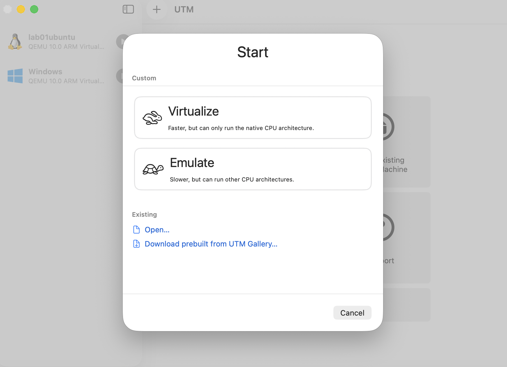
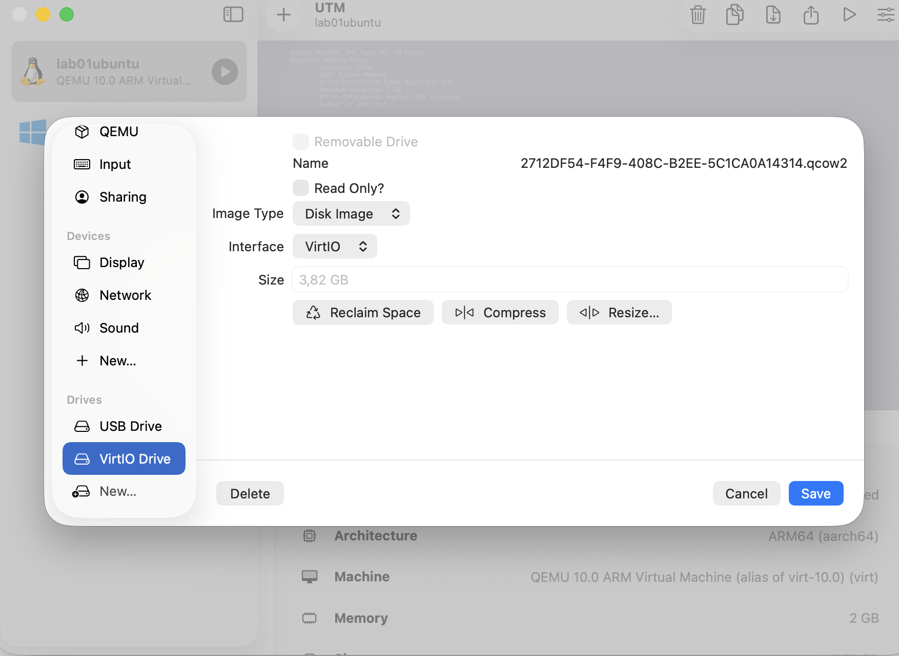
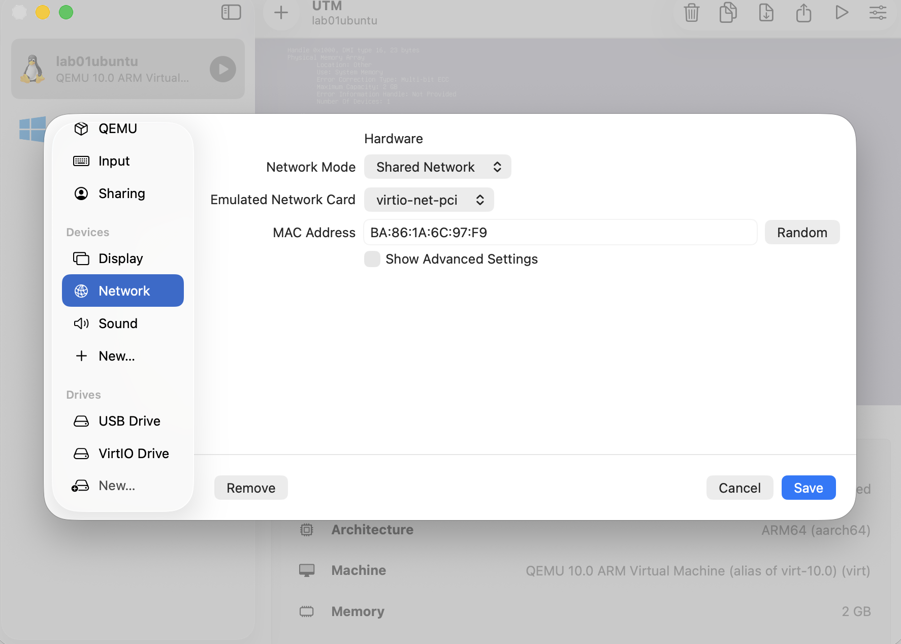
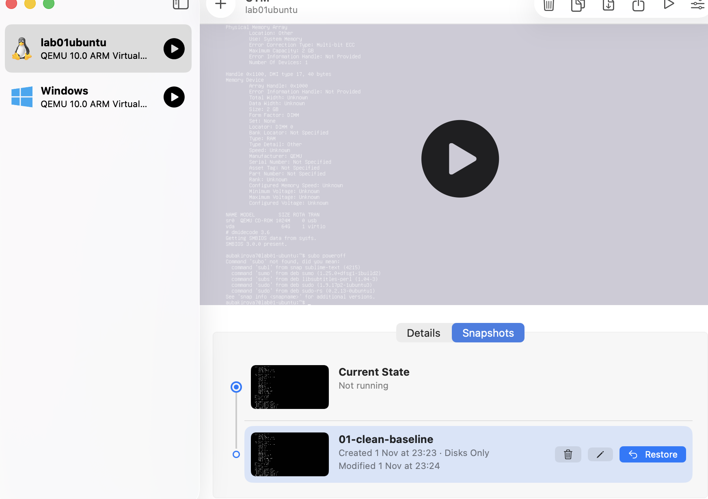

# Standard Operating Procedure: Provisioning a Developer Test VM

This guide walks an operator through setting up a clean, isolated virtual machine on Apple Silicon macOS using UTM.

---

## Step 1. Open the New Virtual Machine Wizard
1. Open **UTM** from your Applications folder.
2. Click the **+** (Create a New Virtual Machine) icon at the top.
3. Select **Virtualize**.

*Why Virtualize:* Selecting "Virtualize" runs the guest operating system directly on the Apple Silicon processor at native hardware speed. Selecting "Emulate" attempts to simulate an Intel chip, making the computer 5–10× slower.

> **Check:** The wizard advances to the "Operating System" choice screen.

---

## Step 2. Select Operating System and ISO
1. Click **Linux**.
2. Under **Boot ISO Image**, click **Browse**.
3. Select your downloaded `ubuntu-24.04-live-server-arm64.iso` installation image.
4. Click **Continue**.

*Why this ISO:* The ARM64 architecture must match the physical Mac chip. Attempting to boot an x86/Intel ISO under virtualization will immediately crash.

> **Check:** The file path to the ISO appears in the selection box without warning indicators.

---

## Step 3. Hardware Resource Allocation
1. Set **Memory** to `2048 MB` (2 GB).
2. Set **CPU Cores** to `2`.
3. Click **Continue**.

*Why these numbers:* Your Mac has 16 GB of RAM. Giving the VM 2 GB provides enough memory for command-line tools, tests, and compilers, while leaving 14 GB free for macOS to run smoothly without system memory pressure.

> **Check:** Memory slider reads 2048 MB and CPU cores reads 2.

---

## Step 4. Disk Storage Configuration
1. Set **Storage Size** to `25 GB`.
2. Leave drive dynamic (default).
3. Click **Continue**.

*Why this size:* A dynamic 25 GB virtual drive only occupies roughly 3–4 GB on your physical SSD immediately after install. It expands only as the developer downloads files.

> **Check:** The disk capacity box displays 25 GB.

---

## Step 5. Network Adapter Mode
1. In the VM summary or configuration screen, open **Network**.
2. Ensure **Network Mode** is set to **Shared Network** (NAT).

*Why Shared Network instead of Bridged:* Campus and office Wi-Fi networks block unknown device addresses (MAC filtering). "Shared Network" uses Network Address Translation (NAT) so the VM shares the host Mac's existing authenticated network connection.

> **Check:** Once booted into Ubuntu, run `ip addr` in the terminal. The network interface should display an assigned IP address (e.g., `192.168.64.x` or `10.0.2.x`).

---

## Step 6. Create the Baseline Snapshot
1. Complete the Ubuntu OS setup (Username: `devuser`, Password: set per office standards).
2. Shut down the virtual machine completely (`sudo poweroff`).
3. In UTM, select the VM, click the **Snapshots** button in the top bar, and click the **+** button.
4. Name the snapshot `01-clean-baseline`.

*Why a snapshot:* If the new developer accidentally modifies critical system files or locks themselves out, you do not need to rebuild the machine. Simply select `01-clean-baseline` and click **Restore** to reset it back to mint condition in five seconds.

> **Check:** The snapshot appears in the list under the VM details with a timestamp.
